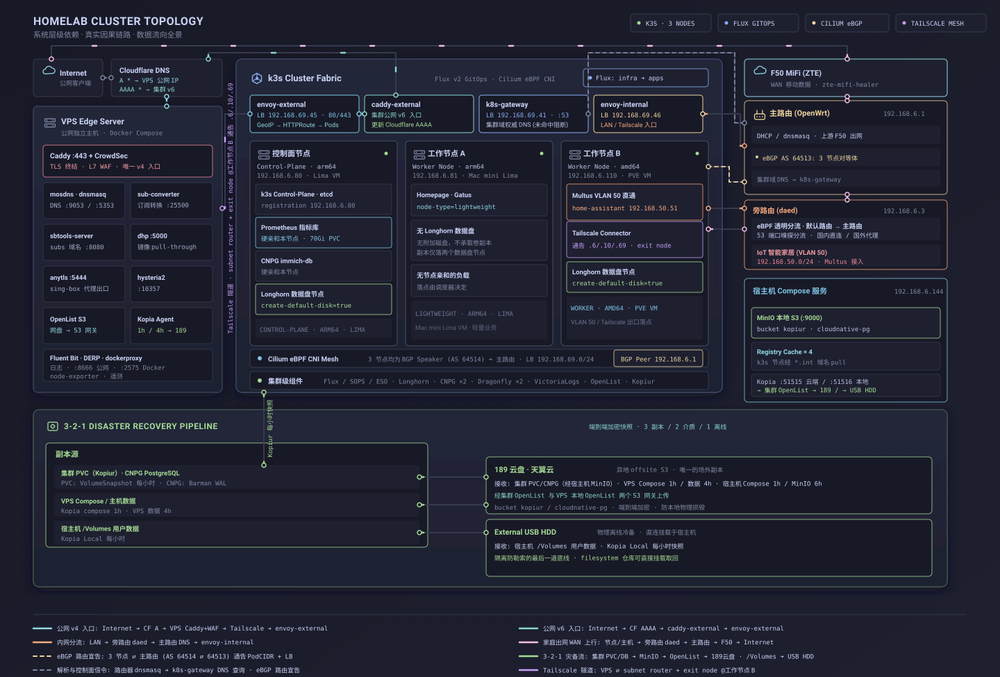
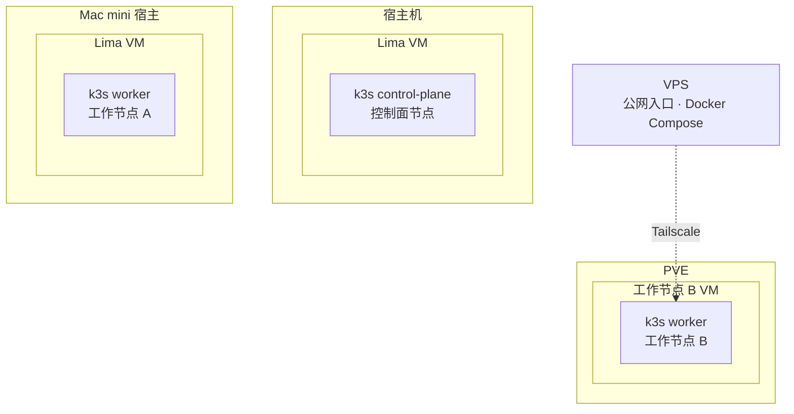
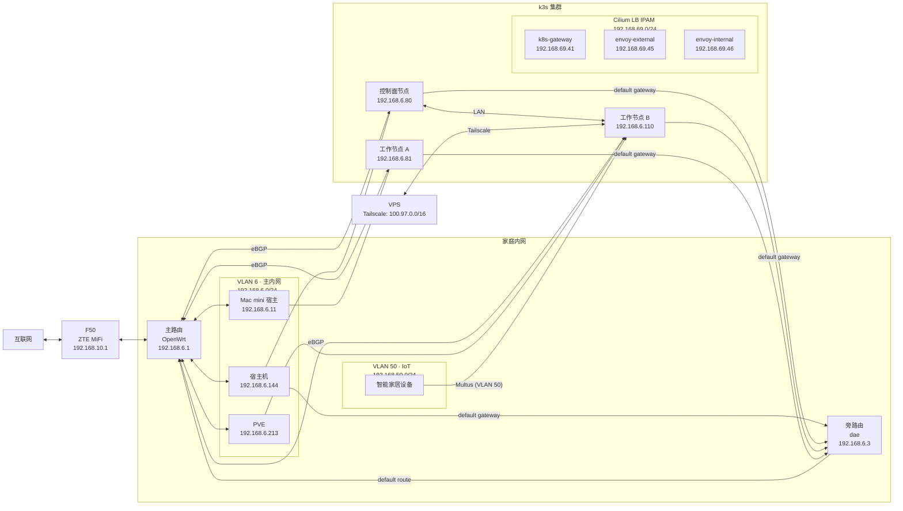
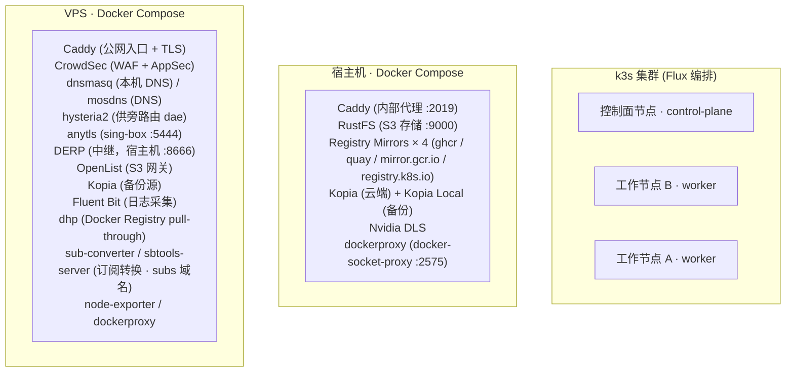
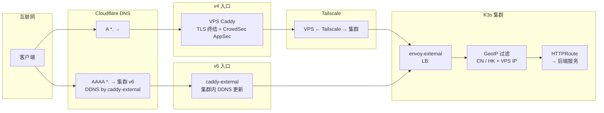
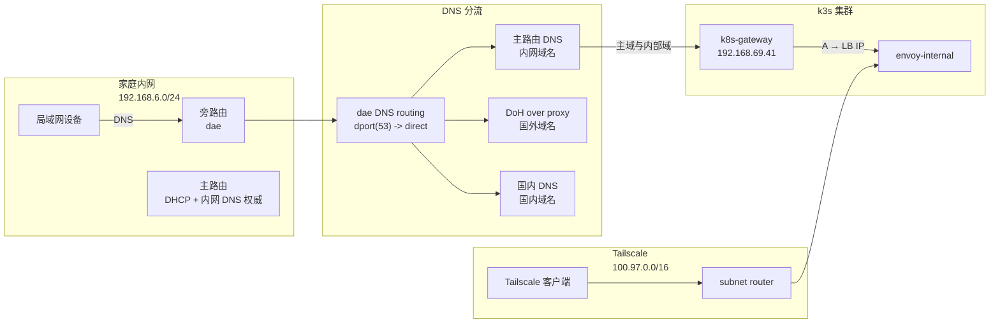
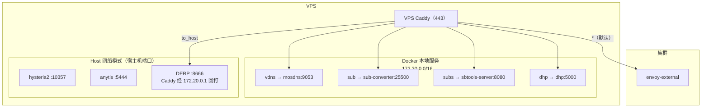
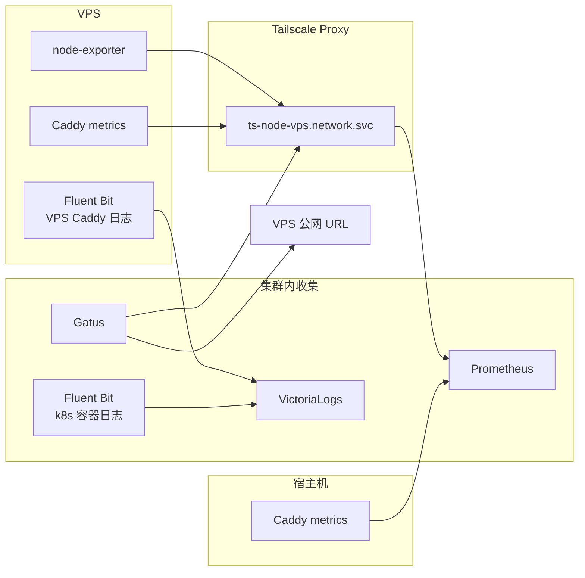
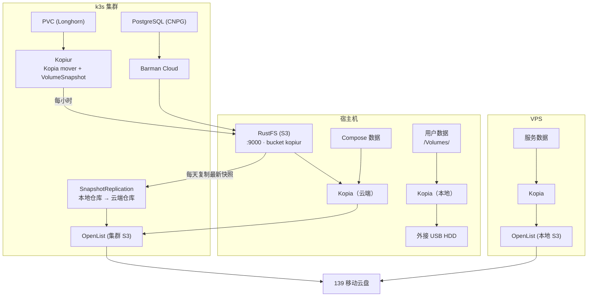
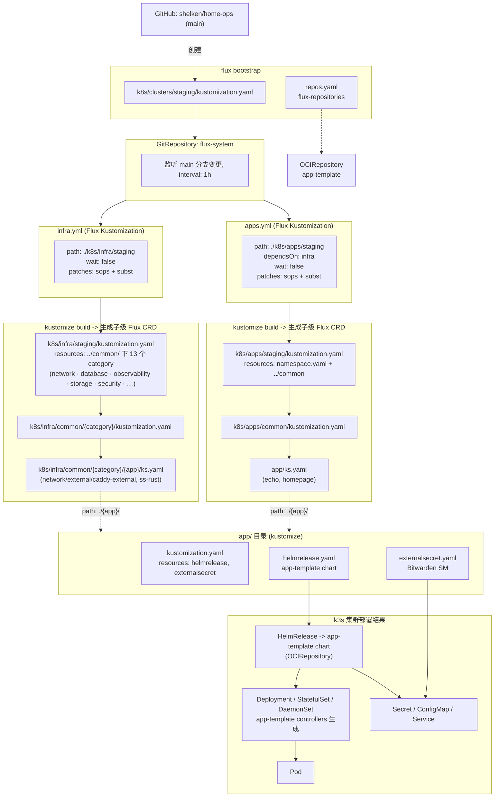

# 架构总览

> 本文件描述整个 homelab 的物理部署、服务分布、网络入口、
> 监控采集和备份链路。公网入口地址以占位符表示，内网地址与网段按真实值描述（架构图中的 envoy-external 地址除外）。



> 图中一条连线只表达一个关系，两端吸附到具体卡片；实线为数据流（配色见底部图例），虚线为解析与控制面信令（DNS 查询、eBGP 路由宣告）。
> 自上而下的层级即为真实依赖顺序：公网与解析 → VPS 边缘 / 家庭网络 → 覆盖隧道 → k3s 集群 → 3-2-1 容灾。

---

## 组件清单

- 编排与 GitOps：k3s、Flux CD v2
- 网络：Cilium、Multus、Envoy Gateway、External-DNS、Tailscale
- 密钥：SOPS、External Secrets、Bitwarden Secrets Manager
- 数据与存储：CloudNativePG、Dragonfly、Longhorn、OpenEBS、SMB CSI
- 备份：kopiur（VolumeSnapshot + Kopia mover）每小时写入集群外 RustFS；再由 SnapshotReplication 每天将最新快照复制到 139 网盘 WebDAV（`yun139`）
- 可观测性：Prometheus、Grafana、Gatus、VictoriaLogs、Fluent Bit

## 1. 物理部署



## 2. 网络拓扑



### 连接方式

| 链路 | 方式 | 说明 |
|------|------|------|
| F50 ↔ 互联网 | WAN (移动数据) | F50 是主路由的互联网出口 |
| 主路由 ↔ F50 | LAN | 主路由通过 F50 出网；F50 断线时 zte-mifi-healer 自动重连 |
| 旁路由 ↔ 主路由 | LAN (VLAN 6) | 旁路由 (dae，配置由 `task router:dae:sync` 下发，见 [ADR-0007](adr/0007-bypass-router-dae-declarative.md))；自身默认路由仍指向主路由 |
| k3s 节点 / 宿主机 → 旁路由 | LAN (VLAN 6) | 默认网关指向 192.168.6.3 (dae)；节点主网卡 DNS 设为 1.1.1.1 触发 eBPF 嗅探分流 |
| k3s 节点 IPv6 | LAN (VLAN 6) | 节点禁用 RA 默认网关，无 IPv6 出网，境外访问回退 IPv4 经旁路由（[ADR-0005](adr/0005-k8s-node-no-ipv6-egress.md)）；需要 IPv6 直连的 Pod 通过 `multus-ipv6` 在自己的网络命名空间里独立出入站 |
| 宿主机 ↔ 主路由 | LAN (VLAN 6) | 192.168.6.0/24 |
| PVE ↔ 主路由 | LAN (VLAN 6) | 192.168.6.0/24 |
| Mac mini 宿主 ↔ 主路由 | LAN (VLAN 6) | 192.168.6.0/24，宿主有线桥接 |
| IoT 设备 ↔ 主路由 | LAN (VLAN 50) | 192.168.50.0/24 |
| IoT 设备 → k3s pods | Multus CNI | VLAN 50 由 multus-iot 直通 Pod（home-assistant 192.168.50.51），调度偏好工作节点 B |
| 控制面节点 ↔ 工作节点 B / 工作节点 A | LAN (VLAN 6) | k3s 节点间通信 |
| 主路由 ↔ k3s 节点 | eBGP | Cilium 向主路由通告 PodCIDR 和 LoadBalancerIP |
| Cilium LB IPAM | 192.168.69.0/24 | k8s-gateway: 192.168.69.41；envoy-external: 192.168.69.45；envoy-internal: 192.168.69.46 |
| VPS ↔ 工作节点 B | Tailscale | 100.97.0.0/16，subnet router + exit node 由 operator Connector `ts-router` 承载（调度偏好工作节点 B），通告 192.168.6.0/24、192.168.10.0/24、192.168.69.0/24 |

---

## 3. 服务分布

> 本节只列主要 Compose 服务，不是完整容器清单；辅助容器以实际 `docker-compose.yml` 为准。



---

## 4. 入口流量全景

### DNS 解析链

```
用户服务:  A *. → <VPS_IP>

内部 DNS:  CNAME homelab-external → homelab-dynamic
              ├── A: VPS IP（手动）
              └── AAAA: 集群 v6（DDNS，由集群内 caddy-external 更新）

ExternalDNS 自动管理各服务子域名的记录

VPS 本机 DNS:
  127.0.0.1 -> dnsmasq
               INTERNAL_DOMAIN 与 MAIN_DOMAIN -> k8s-gateway（更具体的内部域规则优先）
               其他域名 -> 公网 DNS（1.1.1.1 / 8.8.8.8）

K8s 节点本机 DNS (Ansible):
  systemd-resolved -> 1.1.1.1 / 8.8.8.8 (经旁路由 dae 嗅探)
                       ├── 境内域名 -> alidns (223.5.5.5) -> 直连
                       ├── 境外域名 -> 海外 DoH -> 走代理
                       └── 内网域名 (*.int 与 *.lan) -> 主路由 (192.168.6.1)

### 流量路径



### 内网入口与旁路由 DNS



### 内网记录归属

- **集群内权威**：`k8s-gateway` 根据 HTTPRoute、Service 与 Ingress 动态应答
- **主域未命中记录**：由 `k8s-gateway` 转发到公网递归
- **内部域未命中记录**：由 `k8s-gateway` 直接在内存返回 NXDOMAIN/NODATA，不向外递归也不回踢路由器（消除转发死循环）
- **集群外自举**：`router/dnsmasq/conf.d/30-bootstrap.conf.tpl` 下发为 home-ops 专用目录中的
  `30-bootstrap.conf`，用 `address=` 与 `local=` 对记录名本地权威应答（A 与 AAAA 都不转发）
- **路由器分流**：`router/dnsmasq/conf.d/` 下的配置统一下发到
  `/etc/dnsmasq-home-ops.d`，`/etc/dnsmasq.conf` 中的机器级接入点加载该目录
- **OpenWrt 所有权**：UCI `confdir` 保持未设置，默认临时目录及 LuCI/UCI 手工配置继续生效

检查方式：

```bash

task router:dns:diff
ssh <ROUTER> 'cat /etc/dnsmasq.conf'
ssh <ROUTER> 'ls -la /etc/dnsmasq-home-ops.d'
ssh <ROUTER> 'cat /etc/dnsmasq-home-ops.d/*'

```

后端与所有权决策见 [ADR-0003：集群服务 DNS 由 k8s-gateway 动态应答](adr/0003-internal-dns-via-gateway.md)。
旁路由分流与节点 DNS 策略见 [ADR-0004：K8s 节点 DNS 显式指向外部地址，经旁路由 dae 解析](adr/0004-k8s-node-dns-daed-routing.md)。

### 内部域契约

决策见 [ADR-0002](adr/0002-internal-domain-layering.md)。

- **域名分层**：内部入口用 `${INTERNAL_DOMAIN}`（`int.<MAIN_DOMAIN>`），公网入口用 `${MAIN_DOMAIN}`
- **证书**：主域 Certificate 含 `*.${INTERNAL_DOMAIN}`，与主域共用同一 Secret，见 `k8s/infra/common/network/certificates/export/certificate.yaml`
- **不发布到公网**：Cloudflare 的 ExternalDNS 只观测 `envoy-external`，公网没有内部域记录。在家用网络内直接 `dig` 会被本机网络拦截而返回内网地址，复核用 DoH：

  ```bash

  curl -s -H 'accept: application/dns-json' 'https://cloudflare-dns.com/dns-query?name=x.<INTERNAL_DOMAIN>&type=A'

  # 公网应为 Status 3（NXDOMAIN）

  ```

- **解析路径**：

  | 客户端 | 路径 |
  |---|---|
  | LAN 设备、VPS | 路由器或 VPS 的 dnsmasq → k8s-gateway；集群外自举名称为路由器 `30-bootstrap.conf` 中的 `address=` 记录 |
  | K8s 节点 | 经旁路由 dae 转回主路由，见 [ADR-0004](adr/0004-k8s-node-dns-daed-routing.md) |
  | SFM 客户端 | 由 proxy 仓库的 sing-box 配置在本地静态应答，不依赖家庭 DNS，见 [proxy #46](https://github.com/shelken/proxy/issues/46) |

- **入口 IP 变化**：路由器 `30-bootstrap.conf` 与各客户端的静态应答要同时更新，否则两侧指向不同入口

### 入口一览

| # | 入口 | 协议 | DNS 链 | 终点 | 状态 |
|---|------|------|--------|------|------|
| 1 | VPS Caddy (v4) | 公网 | A `*` → VPS → Tailscale | envoy-external | ✅ 活跃 |
| 2 | caddy-external (v6) | 公网 | AAAA `*` → 集群 v6 | envoy-external | ✅ 活跃 |
| 3 | envoy-internal | 内网 | 客户端 DNS → 旁路由 dae → 主路由 DNS → k8s-gateway → LB | envoy-internal | ✅ 活跃 |
| 4 | Tailscale | 内网 | 直连 → subnet router | 集群服务 | ✅ 活跃 |
| ~5~ | Cloudflare Tunnel | 无 | 无 | 无 | ❌ 已停用 |
| ~6~ | NetBird | 无 | 无 | 无 | ❌ 已停用 |

> 内网 DNS 里除集群服务外还有集群外内部服务（宿主机上的 rustfs、镜像代理、PVE 面板等），它们解析到 192.168.6.144，不经 envoy

---

## 5. VPS Caddy 路由



| 域名 | 路由目标 | 说明 |
|------|---------|------|
| `*`（默认） | → Tailscale → envoy-external | 大部分服务 |
| `sub` | → 本地 sub-converter:25500 | 订阅转换 |
| `subs` | → 本地 sbtools-server:8080 | 配置交付服务 |
| `derp` | → 宿主机 :8666（Caddy 经 172.20.0.1 回打） | Tailscale 中继 |
| `dhp` | → 本地 dhp:5000 | Docker 镜像 pull-through 代理 |
| `vdns` | → 本地 mosdns:9053 | DNS 服务 |

> hysteria2、anytls、dnsmasq 不经过 Caddy，直接使用宿主机端口

---

## 6. 监控与日志采集



### 采集目标

| 数据源 | 代理方式 | 采集方式 |
|--------|---------|---------|
| VPS node-exporter | ts-node-vps:9100 | Prometheus |
| VPS Caddy metrics | ts-node-vps:2019 | Prometheus |
| VPS Docker 状态 | ts-node-vps:2575 | Gatus / Homepage |
| 宿主机 Caddy | 192.168.6.144:2019 | Prometheus |
| VPS Caddy 访问日志 | VPS Fluent Bit | VictoriaLogs |
| k8s 容器日志 | 集群 Fluent Bit | VictoriaLogs |

---

## 7. 备份链路



### 备份配置

| 链路 | 备份源 | 存储后端 | 目标 | 调度 |
|------|--------|---------|------|------|
| k8s PVC（本地） | Longhorn VolumeSnapshot | Kopiur（Kopia mover）→ RustFS (宿主机 S3, bucket kopiur) | 宿主机本地 | 每小时 |
| k8s PVC（云端副本） | 本地仓库 `sakamoto` 的最新快照 | Kopiur SnapshotReplication（`kopia snapshot migrate`）→ ClusterRepository `yun139`（WebDAV → 集群 OpenList `/dav/kopiur`） | 139 云盘 | 每天 |
| PostgreSQL | CNPG 集群 | Barman → RustFS (宿主机 S3) | 139 云盘 | 按 WAL 归档 |
| 宿主机 RustFS | RustFS 数据（不含 kopiur 桶） | Kopia → OpenList (WebDAV) | 139 云盘 | 每天 03:30 |
| 宿主机 Compose | Compose 数据 | Kopia → OpenList (WebDAV) | 139 云盘 | 1 小时 |
| 宿主机本地 | 用户数据 (`/Volumes/<USER_DATA>`) | Kopia Local → 外接 USB HDD | 本地 | 每小时 |
| VPS 服务数据 | VPS 数据 | Kopia → OpenList (VPS WebDAV) | 139 云盘 | 4 小时 |

> Kopia 仓库配置通过 `.env.tpl` 从外部密钥管理注入，不提交到 Git
> 139 云盘是 OpenList 的运行时存储配置，不在 Git 内声明

---

## 8. Flux 部署链路



### 部署顺序

| 层 | Kustomization | 入口 | 等待上游 | 说明 |
|---|-------------|------|---------|------|
| 0 | `flux-system` GitRepository | 由 bootstrap 创建 | 无 | 监听代码仓库，触发所有同步 |
| 1 | `flux-repositories` | `repos.yaml` → `k8s/clusters/common/repos/` | 无 | 预注册 Helm chart 源（app-template 等） |
| 2 | `infra` | `infra.yml` → `k8s/infra/staging/` | 无 | 基础设施先部署，`wait: false` |
| 3 | 各 infra 子 Kustomization | `k8s/infra/common/{category}/<app>/ks.yaml` | infra 层父级 | 网络、存储、数据库、监控等 |
| 4 | `apps` | `apps.yml` → `k8s/apps/staging/` | infra 完成 | 应用层后部署，`wait: false` |
| 5 | 各 apps 子 Kustomization | `k8s/apps/common/<app>/ks.yaml` | apps 层父级 | 普通业务应用 |

### 关键机制

- **变量注入**：所有子 Kustomization 自动获得 `cluster-secrets`（Secret）和 `cluster-settings`（ConfigMap）中的 postBuild 变量。可通过标签 `substitution.flux/disabled: "true"` 跳过。
- **SOPS 解密**：所有子 Kustomization 自动获得 SOPS age 解密能力。
- **等待策略**：两层均 `wait: false`，顺序由 `apps.dependsOn: infra` 保证（成因见 [024](../postmortems/024-flux-wait-recursion-retry-gap-freezes-apps.md)）
- **失败重试**：子级须声明 `retryInterval`，巡检 `scripts/verify-ks-retry-interval.sh`
- **HelmRelease**：最终通过 `app-template` chart（OCIRepository）或直接 Helm chart 部署 Pod。
