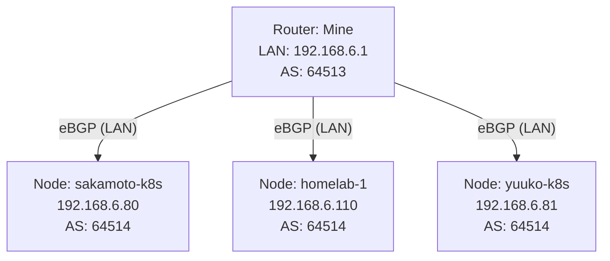

# Cilium BGP 与网络配置

> 状态：本地站点正常（`sakamoto-k8s` / `homelab-1` / `yuuko-k8s` 与 `router-mine` 建立 eBGP 对等）
> 跨地域部分（`router-home` 经 ZeroTier 中继）已断开
### router-mine (192.168.6.1)

[/etc/bird.conf](../../../../../router/bird/mine.conf)

逐节点显式配置 neighbor（无网段接受），本地节点：`sakamoto-k8s`、`homelab-1`、`yuuko-k8s`



### router-home（已断开）

参考配置：[`router/bird/home.conf`](../../../../../router/bird/home.conf)

### 防火墙规则

主路由防火墙配置：`/etc/config/firewall`

`NOTRACK` 告知 Netfilter 跳过连接跟踪，避免因为非对称路由（未看到回程包）丢弃后续 ACK/TLS 握手数据：

```conf
config rule
	option name 'Allow-K8s-LB-Asymmetric'
	option src 'lan'
	option dest 'lan'
	list proto 'all'
	option dest_ip '192.168.69.0/24'
	option target 'NOTRACK'
```

对于本地站点 Pod CIDR（`10.42.0.0/16`）流量，确保相应接口区域之间启用转发规则

```bash
# Check BIRD status
birdc configure check
birdc configure
birdc show protocols
birdc show route
```
